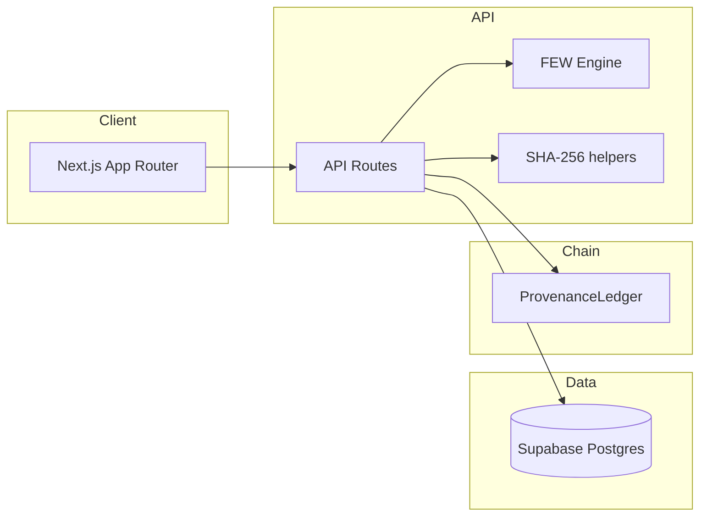

# NexusLens

**NexusLens** is a Blockchain-Enhanced Interactive Food–Energy–Water (FEW) Nexus Scenario Modeling Platform. It targets policymakers, researchers, and students who need transparent, reproducible scenario analysis with cryptographic provenance anchored on an Ethereum-compatible network (Polygon Amoy for testnet deployment).

## Research context

Final-year Computer Engineering research project framing (University of Lagos): the tool couples a lightweight system-dynamics-style FEW engine, interactive dashboards, and a minimal Solidity ledger that stores only hashes (never raw scenario data).

## Architecture



1. **Browser** — Scenario configuration, charts (Recharts), animations (Framer Motion), shadcn/ui.
2. **API routes** — Model execution, Supabase persistence (service role for trusted writes), optional on-chain recording via `ethers` v6.
3. **Supabase** — `scenarios`, `scenario_results`, `provenance_records`, `profiles`, RLS for user-owned rows.
4. **Hardhat + Polygon Amoy** — `ProvenanceLedger.sol` records combined SHA-256 digests and exposes `validateHash`.

## Prerequisites

- **Node.js** 18+ and **pnpm** (recommended; `npm` works with minor script changes)
- **Supabase** project (URL + anon + service role keys)
- **MetaMask** (or any wallet) for Amoy test POL when deploying/recording on-chain
- **Polygonscan API key** (optional, for contract verification)

## Setup

1. **Clone and install**

   ```bash
   pnpm install
   ```

2. **Environment**

   Copy `.env.local.example` to `.env.local` and fill Supabase and blockchain variables.

3. **Database**

   In the Supabase SQL editor or CLI, apply `supabase/migrations/001_initial.sql` (or `pnpm db:migrate` if using Supabase CLI linked to the project).

4. **Smart contract**

   ```bash
   pnpm chain:compile
   pnpm chain:node
   # another terminal:
   pnpm chain:deploy:local
   ```

   For Amoy:

   ```bash
   pnpm chain:deploy:amoy
   ```

   Set `NEXT_PUBLIC_CONTRACT_ADDRESS` to the deployed address. Ensure `RECORDER_PRIVATE_KEY` corresponds to an **authorized** recorder (contract owner is authorized by default; use `addAuthorizedRecorder` for a dedicated bot wallet).

5. **Run the app**

   ```bash
   pnpm dev
   ```

   The Next.js app embeds the contract ABI in `lib/blockchain/contract.ts`, so you do **not** need `pnpm chain:compile` just to run or build the web app. Use Hardhat when developing or testing `contracts/`.

6. **Optional seed**

   Set `SEED_USER_ID` to a real `auth.users` / `profiles.id` UUID, then:

   ```bash
   pnpm seed
   ```

## Tests

```bash
pnpm test          # Vitest — FEW engine unit tests
pnpm chain:test    # Hardhat — ProvenanceLedger tests
```

## FEW model (summary)

`lib/model/fewEngine.ts` implements stylized coupled dynamics among water, energy, and food indices, normalized to 0–100, with Nigeria-scaled absolute magnitudes for illustration. Four presets (`baseline`, `efficiency`, `production_expansion`, `renewable_transition`) ship with tuned parameters. Sensitivity uses finite differences on selected parameters.

## Blockchain provenance flow

1. Run model → compute `inputHash`, `outputHash`, `parametersHash`, `modelVersionHash`, then `combinedHash` (see `lib/blockchain/hash.ts`).
2. Persist results in `scenario_results`.
3. Call `recordProvenance` on `ProvenanceLedger` (or catch errors and still store a `provenance_records` row with `verification_status = 'pending'`).
4. Explorers and `validateHash` on-chain can confirm that a given combined hash matches the stored record.

## Scripts (from `package.json`)

| Script | Purpose |
|--------|---------|
| `pnpm dev` | Next.js dev server |
| `pnpm build` / `pnpm start` | Production build / start |
| `pnpm chain:compile` | Hardhat compile |
| `pnpm chain:test` | Contract tests |
| `pnpm chain:node` | Local Hardhat node |
| `pnpm chain:deploy:local` / `chain:deploy:amoy` | Deploy script |
| `pnpm db:migrate` | Supabase migration push (CLI) |
| `pnpm seed` | Optional DB seed |

## Deploy to Vercel

1. Push this repo to **GitHub**, **GitLab**, or **Bitbucket**.
2. In [Vercel](https://vercel.com/new), **Import** the repository and select the project root (this folder).
3. **Environment variables** — add the same keys as `.env.local.example` in **Project → Settings → Environment Variables** (Production and Preview):

   | Name | Notes |
   |------|--------|
   | `NEXT_PUBLIC_SUPABASE_URL` | Supabase project URL |
   | `NEXT_PUBLIC_SUPABASE_ANON_KEY` | Public anon key |
   | `SUPABASE_SERVICE_ROLE_KEY` | **Server only** — never expose to the client |
   | `NEXT_PUBLIC_CONTRACT_ADDRESS` | Deployed `ProvenanceLedger` address |
   | `POLYGON_AMOY_RPC_URL` | Amoy RPC, e.g. `https://rpc-amoy.polygon.technology` (or your provider) |
   | `RECORDER_PRIVATE_KEY` | **Server only** — wallet authorized to call `recordProvenance` |
   | `NEXT_PUBLIC_APP_URL` | Your Vercel URL, e.g. `https://your-app.vercel.app` |
   | `NEXT_PUBLIC_APP_NAME` | Optional display name |

   Optional: `DEPLOYER_PRIVATE_KEY`, `POLYGONSCAN_API_KEY` (not required for the running site).

4. **Deploy** — Vercel runs `npm install` (from `package-lock.json`) and `next build`. No Hardhat step is required on Vercel.

5. **Supabase Auth** — in the Supabase dashboard, add your production URL under **Authentication → URL configuration** (Site URL and redirect URLs), e.g. `https://your-app.vercel.app` and `https://your-app.vercel.app/**`.

CLI alternative (from a machine with Node/npm): `npx vercel link` then `npx vercel --prod`.

## License

MIT (align with smart contract SPDX).
